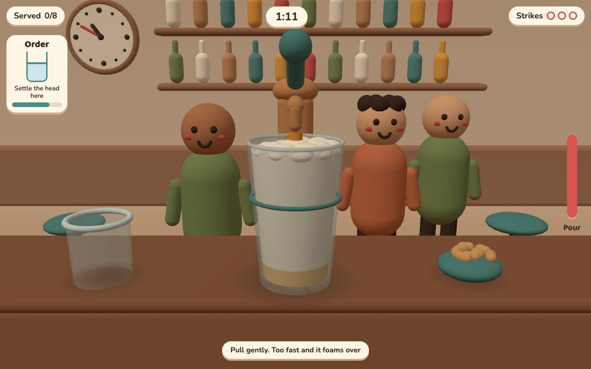
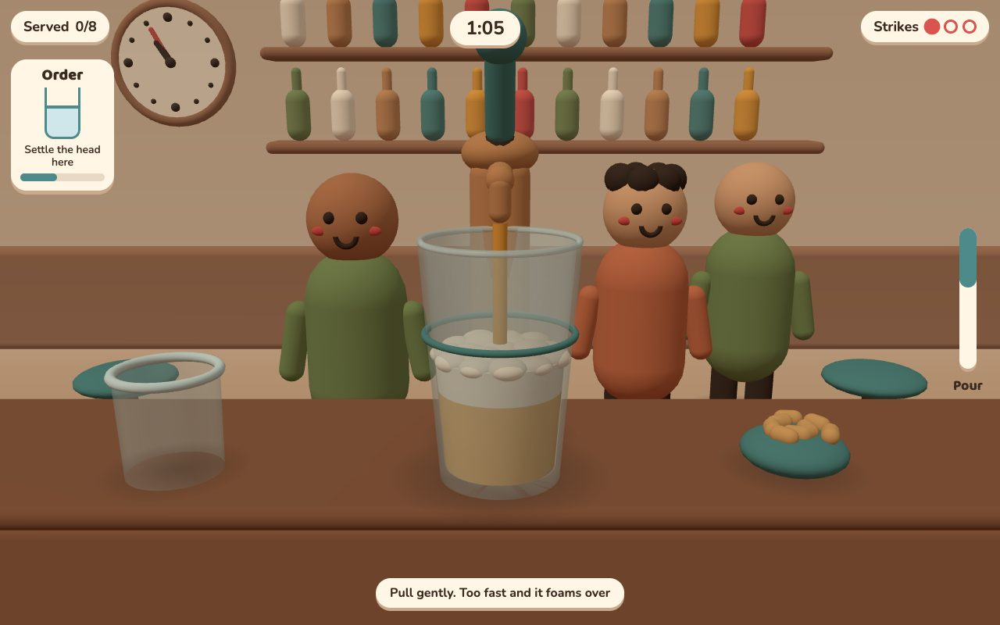
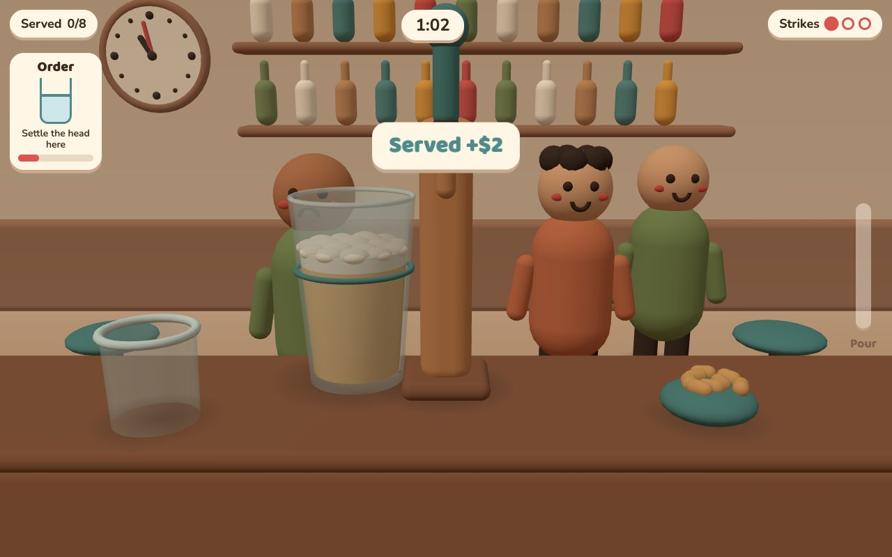
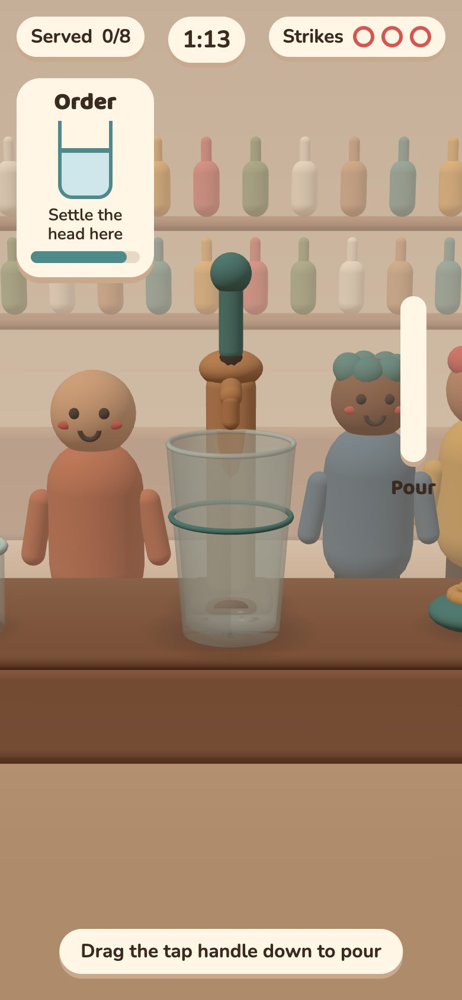

# browser-game-to-portal

> A Claude Code skill that takes a small browser game from "I have an idea" to live on CrazyGames, Poki, itch.io and Newgrounds.

## Overview

You describe your game, or say you don't have one yet. Claude helps you pin it down to one rule, builds it in small approved steps, checks that real players actually finish a round, and packages it for game portals. You don't need to code. Your job is to play each version and say what feels off.

Based on [@0xbobaaa's guide](https://x.com/0xbobaaa/status/2112514472078115173) to building *Skyhold* with Claude Opus 5.5: 22 build steps, about $164, 9 days from an empty folder to passing CrazyGames' QA on the first try.

## Built with this skill: Head Room

[](https://head-room.vercel.app)

**▶ Play it: [head-room.vercel.app](https://head-room.vercel.app)** (desktop or phone)

*Pour too fast and it foams over.* Drag the tap handle down. The further you pull, the faster it pours and the more foam builds. Serve 8 orders before closing. Spills and walk-outs are strikes.

This was the skill's end-to-end test, starting from "how about a game centred on a brewery?":

- **Rule:** the brainstorm pitched 5 brewery rules and cut one ("yeast doubles every few seconds" fails the 2-second test). The pick was *pour too fast and it foams over*.
- **Route:** real beer is PEGI 16+, so CrazyGames (PEGI 12) and Poki are out. The skill's mature route sent it to its own site on Vercel, plus itch.io.
- **Look:** soft clay diorama, Baloo 2 + Nunito, self-hosted.
- **Build:** a day-one pass on Opus (**$2.26, 9.5 minutes**, 1,753 lines), then a sound pass (**$1.01, 2.8 minutes**). Everything is synthesized in code: a pour that follows your pull, a fizz warning near the rim, a serve clink, strike thuds, win/lose stings, and mute. 3.1 MB total, zero external requests.
- **What the test caught:** 8 problems in the skill itself, all fixed. The biggest one: headless passes were quietly loading the user's personal `~/.claude` instructions.

| Pouring gently | Served | On a phone |
|---|---|---|
|  |  |  |

*Status: a day-one build. It's untuned and hasn't had a human playtest yet; the next passes tune the pour and fix the phone layout.*

## How it works

1. **Find the rule.** One sentence a stranger gets in 2 seconds. No idea yet? Claude asks four questions and pitches five options. You pick.
2. **One-page plan.** The loop, how you win, how you lose, and controls on desktop and phone.
3. **Pick the look and sound.** Choose from 7 code-only 3D styles (low-poly, toon, voxel, clay, isometric, neon, pixel), a free font pair, and a sound character. It's saved as `STYLE.md`, so every pass keeps the same look. Sound is synthesized in code, starting with the **warning cue** that plays right before you fail.
4. **Small passes.** Each Claude run builds one feature and gets a **keep list** of what's already approved, so new work doesn't break old work. You play after every pass.
5. **Fix the first minute.** Track visited → opened → started → finished. No new features until people finish a round.
6. **Home page + self-recording trailer.** Your own site with PLAY on top, then the rules, an interactive rule demo, and a build log. A `?capture` mode plays the game on autopilot and saves frames for clips and covers.
7. **One adapter, one zip per portal.** Each portal's SDK (the library it requires for saves, ads and mute) sits behind one small layer, so the game code never changes.
8. **Fix the worst number.** After launch: impressions, click rate, play time, next-day return.

You can enter at any step. Claude works out where your project is.

## Install

Requires [Claude Code](https://claude.com/claude-code). The pass runner also needs `bash` and `python3`.

```bash
git clone https://github.com/tmoody1973/browser-game-to-portal ~/.claude/skills/browser-game-to-portal
```

Then, in Claude Code, try one of the [example prompts](#example-prompts).

## Example prompts

### Start from nothing

> Use browser-game-to-portal. Brainstorm a browser game I could ship to CrazyGames. I like cozy games and want one-thumb controls.

Claude asks four quick questions, pitches five one-line rules, and you pick one.

### Or start from one of these ideas

Seeds for inspiration. Each is a working title, one look from the style menu, and **one rule a stranger gets in 2 seconds**. Your own rule beats ours.

| Working title | Look | The rule | Every few seconds you… | Win / lose | Fonts |
|---|---|---|---|---|---|
| **Moss Bridge** | Low-poly pastel · cozy | Every plank sags under whoever crosses it. | Tap to lay a plank in front of a line of sheep | Win: 10 sheep cross. Lose: 3 fall | Fredoka + Nunito |
| **Sticky Chef** | Toon + outlines · punchy | Whatever you throw sticks where it lands. | Flick toppings onto a spinning pizza | Win: match the order in 60 s. Lose: 3 toppings fly off | Lilita One + Rubik |
| **Lava Lift** | Voxel · arcade | The lava rises one block every 3 seconds. | Tap a column to drop a block for your climber | Win: reach the clouds (25 blocks). Lose: lava touches you | Bungee + Rubik |
| **Dough Dam** | Soft clay · tactile | Water always finds the lowest gap. | Press a clay lump onto the newest leak | Win: hold until the village bell (60 s). Lose: water reaches the houses | Baloo 2 + Nunito |
| **Shadow Walk** | Minimal isometric · clever | You can only walk on shadows. | Drag the sun to swing shadow paths across the plaza | Win: reach the door. Lose: 2 s in the light | Outfit + Inter |
| **Pulse Lane** | Neon · fast | You can only change lanes on the beat. | Tap on the beat to dodge the next wall | Win: survive the 60 s track. Lose: 3 hits | Orbitron + Exo 2 |
| **Last Light** | Retro pixel · eerie | Monsters freeze in your light. | Sweep your torch while your character walks to the exit | Win: reach the exit. Lose: a monster touches you | Pixelify Sans |

Use a row as a seed:

> Use browser-game-to-portal. My rule is "The lava rises one block every 3 seconds." Write the one-page doc and STYLE.md (voxel, Bungee + Rubik), then the day-one brief.

That produces a day-one brief like this (the guide's Prompt 1, filled in, plus the skill's Style line):

```
Build a small but polished 3D browser game in this folder, entry point index.html.
The rule: the lava rises one block every 3 seconds.
The loop: tap a column to drop a block; the climber hops onto any block next to it.
Win: the climber reaches the cloud line, 25 blocks up. Lose: the lava touches the climber.
Tech: three.js loaded locally through an importmap, no other scripts, every model and texture built from code.
Style: read STYLE.md and follow it exactly. Fonts are self-hosted in fonts/.
Done means: I can open index.html, play one full round with the mouse, win or lose, and restart.
Do not open a browser. Just write the files. No runtime errors.
```

### Prompts for every stage

| Stage | Say |
|---|---|
| Look | "Show me 3 looks for my game that make the rule readable at thumbnail size, with font pairs." |
| A feature | "Write a pass brief to add a hold slot. Keep list: dropping, tilting, the win screen." |
| Nobody finishes | "Real numbers from today: 51 → 13 → 6 → 0. What do I fix first?" |
| Home page | "Build my game's home page like skyhold.lol: PLAY on top, then the rule with a demo toy, and a build log." |
| Trailer | "Add ?capture mode and record a 20-second clip in landscape and portrait." |
| Portals | "Package my game for CrazyGames, Poki and itch.io, and give me the QA checklist." |
| Covers | "Make my covers: title on the CrazyGames ones, no text on Poki's." |
| Live | "CrazyGames day one: 141 impressions, 1.4% clicked, 3 min play. Which number do I fix?" |

## Running a pass headless

```bash
# From your game's folder. Write a five-part brief (see references/briefs.md) first.
~/.claude/skills/browser-game-to-portal/scripts/run-pass.sh brief.txt scoreboard

# Optional: pick the model and cap the spend
MODEL=sonnet MAX_BUDGET_USD=5 ~/.claude/skills/browser-game-to-portal/scripts/run-pass.sh brief.txt scoreboard
```

Each run saves its raw output to `runs/` and adds a line to `passes.jsonl` with the cost, minutes, and a running project total.

Runs are isolated by default (`--setting-sources project`), so your personal `~/.claude` instructions, hooks and plugins don't leak into the build. The run has file tools only and can't download anything, so put three.js and your fonts in the folder first (see "Setup before day one" in `references/briefs.md`).

**Mature themes** (beer, etc.) can't go on CrazyGames or Poki, which require PEGI 12. The skill routes them to your own site (e.g. Vercel) + itch.io instead.

**Cost warning:** each pass is a real Claude run billed to your account. The guide's passes cost $1.01–$12.94 each on Opus. Use `MAX_BUDGET_USD` to cap a run.

## Structure

```
browser-game-to-portal/
├── SKILL.md              # Stage router, brainstorm, pass loop, defaults, guardrails
├── references/
│   ├── briefs.md         # Five-part brief template + the guide's prompts
│   ├── style.md          # 7 code-only 3D styles, fonts, per-portal cover rules
│   ├── sound.md          # Sound that serves the rule: synth recipes, ZzFX, mute/ad/iOS rules
│   ├── landing.md        # The game's home page (modelled on skyhold.lol)
│   ├── portals.md        # SDK adapter, size budgets, QA gate, launch paths, video specs
│   └── funnel.md         # First-minute funnel and post-launch numbers
└── scripts/
    └── run-pass.sh       # Run one brief headless, log its cost
```

## Caveats

- Portal requirements are as described in the guide (late 2026). Check each portal's current developer docs before submitting.
- Built for small games you can understand at a glance, not big multi-system games.

## Credits & license

The method, the Skyhold numbers, and the prompts marked **verbatim** in `references/briefs.md` come from [@0xbobaaa's article](https://x.com/0xbobaaa/status/2112514472078115173). They're quoted with credit and remain the author's. Everything else is released under the [MIT License](LICENSE).
